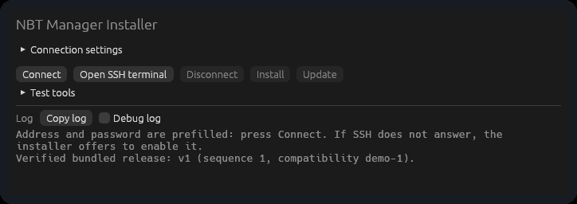
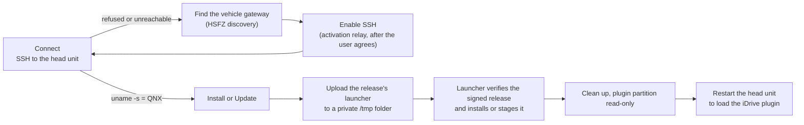

<!-- SPDX-License-Identifier: GPL-3.0-or-later -->
<p align="center">
  <picture>
    <source media="(prefers-color-scheme: dark)" srcset="docs/assets/logo-dark.svg">
    
  </picture>
</p>

<h1 align="center">NBT Manager Installer</h1>

> **Warning: installing or modifying this software can brick your head unit. Recovery may require professional service or replacement, at your expense. Provided AS IS; use at your own risk, subject to applicable law.** [Read the risk and liability disclaimer](DISCLAIMER.md).

<p align="center">
  <b>Put NBT Manager on the car from a laptop,</b><br>
  over the ENET cable: install, update, diagnose.
</p>

<p align="center">
  
</p>

Installs, updates and removes NBT Manager on a BMW NBT Evo (iDrive 6) head unit
over SSH, from a computer on the car's ENET cable or a Wi-Fi ENET adapter. A Rust
desktop application (egui) and the installer core it shares with the NBT Manager
phone app.

**Supported head units:** BMW NBT Evo (iDrive 6). Support for the earlier NBT
may come later.

Part of [NBTFoundry](https://github.com/NBTFoundry):
[manager](https://github.com/NBTFoundry/manager) (what it installs) ·
[mobile-app](https://github.com/NBTFoundry/mobile-app) (phone app, shares the core) ·
[sdk](https://github.com/NBTFoundry/sdk) (application SDK) ·
[doom](https://github.com/NBTFoundry/doom) (example application)

Not affiliated with or endorsed by BMW AG. BMW, iDrive and NBT are trademarks of
BMW AG.

- **Install** verifies and streams the bundled signed release, provisions the
  manager and registers its iDrive plugin.
- **Update** stages a signed release on an existing installation with the
  release's own launcher, whatever launcher is installed. The update is confirmed
  once the manager GUI and worker stay healthy for 30 seconds.
- **Test tools** collect diagnostics, manage the debug log, install a test
  application, edit the controller settings, restart the head unit and remove NBT
  Manager.



## Build and test

Rust 1.99 or later.

```sh
cargo run --locked                    # development build (no release bundled)
cargo test --locked --workspace
```

The workspace has three crates:

| Crate | Path | Contents |
| --- | --- | --- |
| `nbt-installer-core` | `core/` | Everything but the window: the SSH session with Install, Update and the test tools, gateway discovery, the activation relay, the head-unit search, and the signed release and test application embedded at build time (`core/build.rs`, `core/src/bundle.rs`). Every socket is opened through `core/src/net.rs`. |
| `nbt-manager-installer` | `.` | The egui window and the terminal launcher. |
| `nbt-installer-mobile` (library `nbt_installer`) | `mobile/` | The core for the phone app through UniFFI: a `Session` with a `Listener` for events; `confirm_activation`, `install`, `update`, `tool` and `disconnect` act on it. |

`core/src/release.rs` is tested against packages made by NBT Manager's own
packer (`core/tests/fixtures/release/`). After a change to the release format,
rebuild them with `NBT_MANAGER_DIR=../manager python3
core/tests/fixtures/release/regenerate.py`.

**End-to-end test** against a mock SSH server, with the manager's native host
launcher (from a sibling `NBTFoundry/manager` checkout):

```sh
make -C ../manager build/launcher-host
NBT_TEST_LAUNCHER_HOST="$(realpath ../manager/build/launcher-host)" \
  cargo test --locked -p nbt-installer-core native_install_then_update_over_ssh -- --ignored
```

It installs into an empty manager root, then updates to a second release staged
and applied by the uploaded launcher, with a temporary signing key.

**README screenshot.** `tools/capture_window.sh` builds the installer with the
test release fixture bundled (into `target/capture`) and renders
`docs/assets/installer.png` under Xvfb (needs Xvfb, xwd and ImageMagick).

## Release builds

A release build embeds the signed manager release and its trusted public key; the
private key stays on the signing workstation. The build rejects an invalid
release, and the application verifies the embedded release again at start:

```sh
NBT_MANAGER_RELEASE=/path/to/manager.nbtr \
  NBT_MANAGER_PUBLIC_KEY=/path/to/manager-public.pem cargo build --release --locked
```

From the manager repository, `make release installer-release` builds and signs
the release and then this application (`NBT_INSTALLER_DIR`, default
`../installer`). A test application can be embedded too: `NBT_TEST_APP_PACKAGE`,
`NBT_TEST_APP_KEY` and `NBT_TEST_APP_COMPAT`, all three or none. Development
builds may omit everything and report that no release is bundled.

## Install and Update

Install takes five steps, the same every time:

1. Make the iDrive plugin partition writable: `mount -uw /net/hu-omap/fs/sda0`
   (it is mounted read-only at boot).
2. Upload the launcher to a private `/tmp/nbt-manager-<random>` folder.
3. Run it: it verifies the signed release, checks the plugin folder and the
   manager storage, and installs. A refusal names the failed check (for example
   `HMI layout: plugin filesystem is read-only`).
4. Remove the staging folder, also after a failure.
5. Make the plugin partition read-only again, also after a failure
   (`mount -ur /net/hu-omap/fs/sda0`). If that fails the installer says so; the
   partition is read-only again after the next reboot either way.

Update takes six: the same remount, upload and clean-up around two runs of the
uploaded launcher, `--stage-update <bytes> <sha256>` (the release on stdin,
expects `PENDING`) and `--refresh-setup` (replaces the installed launcher and the
iDrive plugin; `REFRESHED` or `REFRESHED plugin`). The installed launcher is never
run, so an older launcher needs no preparation. On a head unit without NBT
Manager, Update says to use Install.

A failure leaves the connection usable, so Install can be retried at once. After
an install, or an update that replaced the iDrive plugin, the installer offers to
restart the head unit; the application never reboots it on its own.

## Test tools

- **Collect everything:** one read-only report over SSH, saved as
  `collect-<time>.txt` in the logs folder. Each section has its command, output,
  standard error and exit status: `uname -a` and `mount`, the debug log,
  `sloginfo`, `audioconn -l`, `pidin arg`, the process manager's overview, the
  capture shim's state and files, and `ls -lR` of the manager's folders and
  `/dev/shmem`. A section that fails or times out is noted and the others still
  run (`core/src/collect.rs`). Read a report before sharing it: the system log can
  hold phone names and Bluetooth or Wi-Fi addresses, and `pidin arg` the head
  unit's MAC address.
- **Debug log:** switch it on (creates `manager/debug.log`), save it, or switch
  it off and delete it.
- **System log:** runs `sloginfo` on the head unit and saves it as
  `slog-<time>.log`. Works with or without NBT Manager installed.
- **Install test application v1:** provisions the application `test` from the
  embedded signed package through the launcher's `--provision-app`. The head unit
  verifies it and refuses to replace an existing application.
- **Controller settings:** edit and write `manager/controller.conf` (prefilled
  with the documented defaults, `core/assets/controller.conf.example`), or remove
  it.
- **Restart the head unit:** runs `OnOffDSICommander appreset`, which restarts the
  whole head unit as switching the car off and on does. SSH goes down with it, so
  the installer disconnects; once the head unit is back, Connect offers to enable
  SSH again.
- **Remove NBT Manager:** after a confirmation, deletes `/var/opt/nbt-manager`
  and the plugin folders `Plugins/NbtManager` and `Plugins/.NbtManager.setup`
  under `/opt/hmi/ID5/data/ro`, nothing else. Running copies keep their open
  files until the reboot that unloads the plugin.

Logs and reports go to `Documents\NBT Manager logs` on Windows, else the
application data folder.

## Remote commands

Each remote command runs in a login shell (`/bin/sh -l -c '…'`), which has the
session's `PATH` and `LD_LIBRARY_PATH`. Commands use only the QNX shell's
built-ins (`echo`, `test`, `umask`, `:`) and `mkdir`, `cat`, `chmod`, `rm`,
`mount`, `sloginfo` and `OnOffDSICommander`, and contain no user input; the
controller settings travel on standard input. The head unit has no `printf` and
no `rmdir`; a test keeps both out.

## Connection

The default address (`169.254.199.119`), port, user and root password are the
head unit's published defaults, built in (`core/src/lib.rs`); the password field
is plain text so it can be read and corrected. Passwords are never logged. Every
SSH host key is accepted without a prompt: the installer only talks to a head
unit on the car's own network, and a reflash changes the key. The key's SHA-256
fingerprint is logged.

**Open SSH terminal** (next to Connect) starts `ssh` from the PATH in a new
terminal with the connection settings (`-o HostKeyAlgorithms=+ssh-rsa -m
hmac-sha1`, host keys not recorded, `-p <port> <user>@<address>`). OpenSSH takes no
password argument, so the installer acts as ssh's askpass program
(`SSH_ASKPASS_REQUIRE=force`, OpenSSH 8.4 and later); an older ssh asks for it.
The fields are validated first (letters, digits, `.`, `-`, `_`; port 1–65535).

**The head unit's sshd** predates rsa-sha2, hmac-sha2 and curve25519/ECDH; group
exchange is the only key exchange it shares with a modern client, and it may
answer with the 2048-bit group 14. The client therefore accepts groups from 2048
bits, as OpenSSH does, and appends HMAC-SHA1, the SHA-1 key exchanges and AES-CBC
after the modern algorithms. A test server configured the same way covers this.
After authentication the client runs `uname -s` to check for QNX.

**Progress:** two bars over the log show the operation's steps and the current
step's bytes, speed and time left. Upload progress counts bytes written to the
SSH socket, not bytes queued.

**Debug log** (checkbox, off by default) shows each remote command (fixed commands
with generated paths, sizes, digests and the compatibility token) and, for a
failed step, its exit status, signal, output and error (up to 4 KiB, escaped),
plus host key and handshake errors. Detail is always recorded, so ticking it after
a failure shows what led there. While ticked, the log is also written to
`installer-<time>.log` in the logs folder.

## Enabling SSH

When the SSH connection cannot be opened (refused, unreachable or timed out), the
installer asks whether to enable SSH:

1. It finds the vehicle gateway by HSFZ discovery (UDP 6811 broadcast). The
   gateway is a different module from the head unit.
2. It relays between the gateway's port 6801 and the activation service
   (`wss://pretzel.bavarian-aa.uk:8443`), showing the service's status messages.
   It sends diagnostic commands to the vehicle; it does not record vehicle
   messages.
3. It connects again.

If activation ends with a protocol or transport error, the installer keeps the
error and checks whether SSH became reachable anyway; an explicit negative result
stops the attempt. Failures after the connection opens (handshake,
authentication) never offer activation.

**Gateway discovery** (`core/src/discovery.rs`) sends the request from every local
IPv4 address (including link-local ones), each to its own subnet's broadcast and
to `255.255.255.255`, plus once from an unbound socket to `169.254.255.255`.
Windows sends a limited broadcast out of one interface only, and a car that took a
DHCP address from a Wi-Fi ENET adapter keeps it after the adapter is unplugged and
answers only on that subnet. Answers are merged by VIN, so one car answering on
two subnets is one gateway. **Connection settings → Gateway** skips the search
and uses the typed unicast IPv4 address.

**Head-unit search** (`core/src/sweep.rs`): behind a Wi-Fi ENET adapter the
computer gets a DHCP address from the adapter and loses its `169.254` address, so
the built-in head-unit address is unreachable, while the head unit itself takes a
DHCP address on the adapter's network. When the configured address does not
answer, the installer searches for the SSH port on the networks a vehicle gateway
answered on, leaving out this device's own addresses and the gateways (which
refuse SSH, and must not be offered the password). Whatever answers still has to
pass `uname -s`. Only those networks are searched; the link-local `/16` is too
large, so the built-in address covers the cable. The search runs before the
Enable SSH offer, since SSH is often already on, and again after enabling it.
Without a `169.254` address (a phone, or a computer behind the adapter), the
built-in address is not tried; after enabling SSH the search repeats every 2
seconds for up to 60 seconds. When nothing is found and the configured address is
link-local while this computer has none, the log and the Enable SSH window give
the addresses to set.

## On a phone

The NBT Manager phone app (`NBTFoundry/mobile-app`, module `car-install`) runs the
same core over a Wi-Fi ENET adapter; its `scripts/build-installer-core.sh` builds
the library from this workspace. By hand, with the Android NDK and `cargo-ndk`
(`rustup target add aarch64-linux-android`):

```sh
cargo ndk -t arm64-v8a -P 29 build -p nbt-installer-mobile --release --locked
cargo build -p nbt-installer-mobile   # host build: the binding is read from it
cargo run -p nbt-installer-mobile --features bindgen --bin uniffi-bindgen -- \
  generate --library target/debug/libnbt_installer.so --language kotlin --out-dir <dir>
```

The release library is stripped of the metadata the binding is generated from; a
host debug build carries the same interface.

A phone cannot rely on routes: the adapter's Wi-Fi has no internet, so Android
either keeps mobile data as the default network and sends car traffic there, or
makes the adapter's Wi-Fi the default and loses the internet. The app therefore
passes `Networks`: the adapter's Wi-Fi handle (`Network.getNetworkHandle()`) and
addresses, and the mobile-data handle. `net.rs` ties every car socket to the
first with `android_setsocknetwork`, and the activation service's socket to the
second, resolving its name there with `android_getaddrinfofornetwork`. Gateway
discovery and the head-unit search then use only the adapter network's addresses.
A computer sets nothing and keeps the system's routes.

## License

Copyright (c) 2026 Fabien Poussin. The desktop installer, its tests, build scripts and documentation are licensed under **GPL-3.0-or-later**; see [LICENSE](LICENSE).

Original NBTFoundry logos, artwork and screenshots are under **MPL-2.0**, including copies in other NBTFoundry repositories. Third-party code, fonts, game data and their notices retain their own terms. Copyright permission for artwork does not grant trademark rights or imply endorsement by BMW AG or id Software.

See [legal/README.md](legal/README.md) for third-party license notices.

The shared Rust core (`core/`) and mobile bindings (`mobile/`) are **MPL-2.0**, including their tests and build scripts; their directories contain the applicable LICENSE. This lets the MPL-licensed phone app use the same core.
